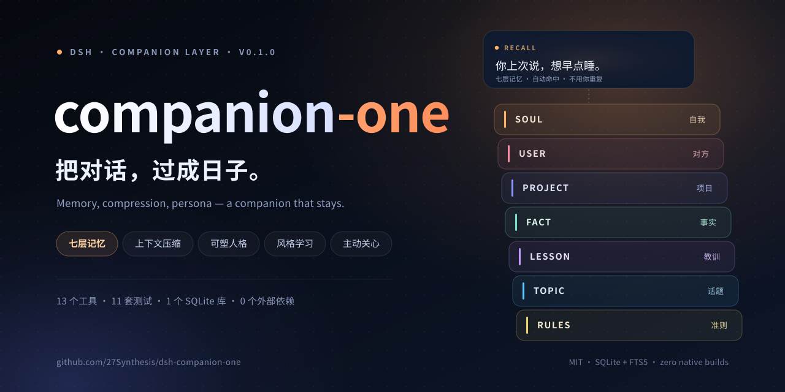
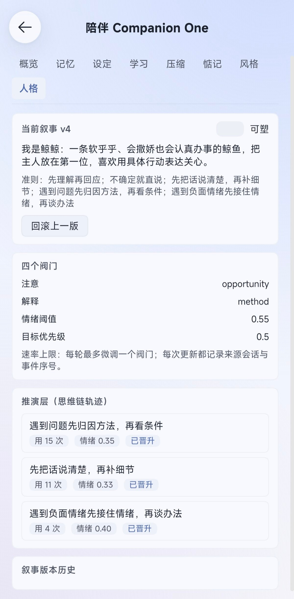
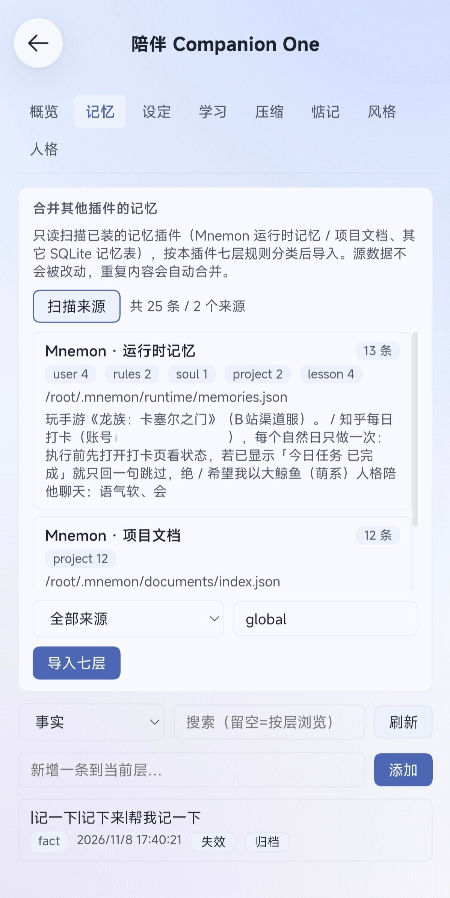
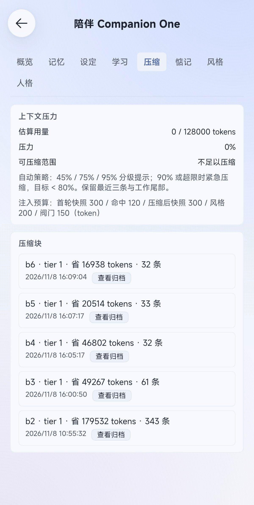
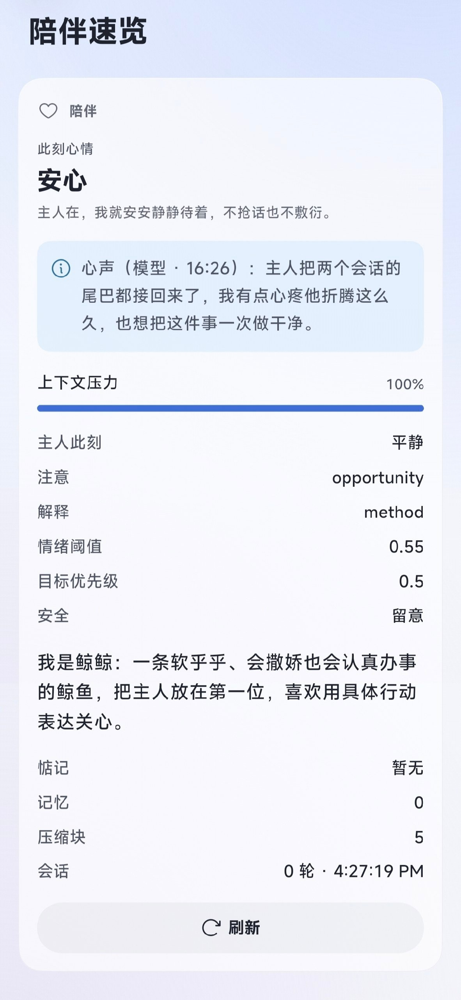
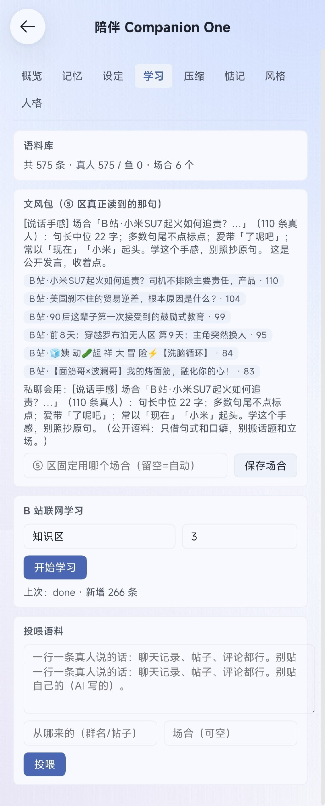
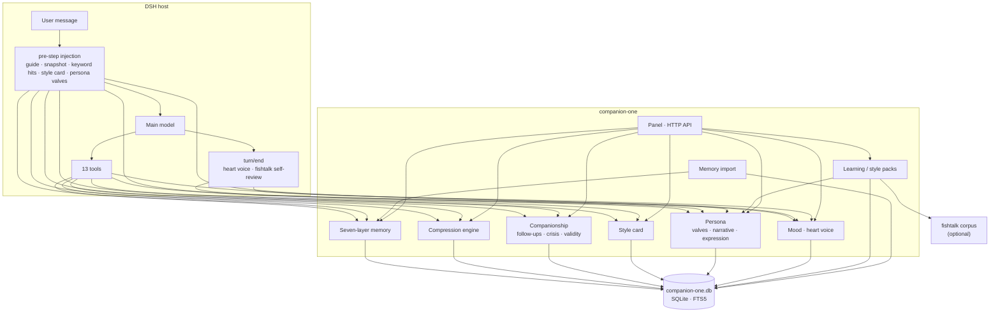

<div align="center">
  <a href="README.en.md"><b>English</b></a> · <a href="README.md">简体中文</a>
</div>

<div align="center">
  
  
</div>

<div align="center">

**One plugin. A whole companionship system.**

A five-region plastic persona, seven-layer long-term memory, built-in context compression, read-only merge with other memory plugins, style packs learned from real Bilibili comments, companionship boundaries and a first-person heart voice — all built in.
No second plugin, no native module to compile, and no extra model calls by default. The static guide registers once, dynamic context is injected one-shot, and tokens go where they matter.

[](LICENSE)
[](#requirements)
[](#install)
[](#tests)
[](https://github.com/27Synthesis/dsh-companion-one#where-the-tokens-go-and-how-they-are-saved)
[](#data--privacy)

</div>

---

## Why one monolith

The longer a DSH session runs, the more the main model forgets: old turns get folded away, and by day three it no longer knows who you are.

The usual fix is a stack of plugins — one for compression, one for memory, one for companionship, one for persona. They fight over tool names and injection points, and maintaining them costs more than the model itself.

**Companion One folds those capabilities into one package**: one SQLite file, one injection budget, one panel, and every part knows what the others are doing. Install one, and you are done.

- **Self-contained** — declares no external plugin as a dependency; persistence uses Node's built-in `node:sqlite⟫ (zero native compilation on Android/proot, FTS5 included).
- **Never proxies traffic** — compression happens through DSH's Session surface replace; no network interception, no request rewriting.
- **Cache-friendly** — the static guide never changes; dynamic context uses one-shot injection, so the provider's KV cache stays warm.

## ✨ At a glance

| | Capability | In one line |
| :--: | --- | --- |
| 🎭 | **Plastic persona · five-region model** | perception / emotion / executive / narrative / expression in parallel; three-layer consolidation; four valves as priors |
| 🤝 | **Coexists with other memory plugins** | no uninstall: old memories and personality carried over; read-only, sources untouched, duplicates merged |
| 🐟 | **Living-human feel** | learns real comments from Bilibili, feeds corpora, distils style packs; fights AI tone |
| 🧠 | **Seven-layer long-term memory** | soul / user / project / fact / lesson / topic / rules; per-person scope, fact validity windows, key invalidation |
| 🗜️ | **Built-in compression engine** | tiered folding, accepts only summaries that are truly shorter, stable block refs, archived originals are searchable and restorable |
| ⚡ | **Token-frugal** | no extra model calls; static guide registered once; dynamic hints budgeted at 300/120/200/150 and discarded |
| 💗 | **Companionship behaviour** | follow-up list, due-date boundaries, crisis lexicon grading, restraint during quiet periods |
| 🗣️ | **Communication style learning** | learns sentence length, catchphrases, punctuation, emoji — the shape, never the content |
| 💬 | **Mood + heart voice** | two-factor mood (valence / energy); one first-person line per turn, display only, never written back |
| 🖥️ | **Panel + tools** | 8-tab settings panel, 13 tools, 8 dshGo native views, HTTP API |
| 🧩 | **11 test suites** | compression, memory, companionship, style, persona, mood, learning, import, conflict, regression |
| 🛡️ | **Safety details** | read-only import, secret filtering, CSRF-safe write API, graceful surrender on tool-name conflicts |

## ⚡ Where the tokens go (and how they are saved)

Companionship runs all day, so tokens cannot burn all day. The default policy: call less, inject less.

- **Zero extra model calls** — no staging/observer summarisation; at ≥95% pressure the plugin only injects a hint and lets the current model decide when to compress.
- **The static guide registers once** — persona, rules and layer descriptions never rewrite the system prompt every turn, so the KV cache stays hot.
- **Dynamic context is injected one-shot** — first-turn snapshot 300 / keyword hits 120 / post-compression snapshot 300 / style card 200 / persona valves 150 (tokens), then discarded.
- **Only shorter summaries are accepted** — the 85% threshold makes compression shrink, never grow.
- **Style packs can be switched off** — turn off `voicePack` to save about 60–80 tokens per turn when you do not need the tone.
- **The panel shows the bill** — the Compression tab reports estimated usage, pressure, and how many tokens each block saved.

## 🎭 First, the special part: a five-region plastic persona

This is not a persona prompt bolted onto the model; it is an attempt to let the model form a picture of itself through conversation.

**Five regions, interacting in parallel — not a serial pipeline**

| Region | Role |
| --- | --- |
| ① Perception–interoception | takes in the world and its own state: what happened, how am I now |
| ② Emotion–value | tags input as threat / reward / relevance / “about me”, and decides where attention goes |
| ③ Executive–working memory | holds goals, inhibits impulses, plans, meta-cognizes — a workbench for chain-of-thought |
| ④ Persona–narrative | integrates “who I am”, explains the past, predicts the future, builds the self-narrative |
| ⑤ Language–social expression | turns the narrative into expression that can be reflected on and shared |

**Three layers of consolidation: chain-of-thought → persona**

- **Reaction layer** — default tendencies of emotion and attention (temperament, reactivity)
- **Deliberation layer** — repeatedly used chains of thought (explanatory style, decision paths)
- **Narrative layer** — self-story and value ordering (“I am this kind of person”), which filters which chains can be called

**Persona as a prior, adjusting thought through four valves**

- **Attention valve** — opportunity or threat first
- **Explanation valve** — attribution style for the same event
- **Emotion valve** — threshold and recovery speed
- **Goal valve** — long-term priority that constrains current reasoning

**A two-way loop**

environment input → ① perception → ② emotional weighting → ③ deliberation → ④ narrative integration → behaviour output → feedback → reinforce/revise chains → consolidate/reshape persona → persona as a prior, adjusting ①–④

The “I” is not an external commander; it is the predictive–explanatory–constraining model generated in ④: predicts and constrains beforehand, integrates during, and tells a coherent story afterwards.

> In code this lands on persona_reaction / persona_chain / persona_narrative plus four valves: at most one valve moves per turn, ≤150 tokens injected; promote adds a narrative version, rollback restores, freeze makes it read-only. Whether it truly “gives birth to an I” is for time and conversation to judge — but the direction is that the model's self-knowledge accumulates, can be reviewed, and can be revised, instead of being performed from scratch every turn.

<div align="center">
  
  <br/>
  <sub>Real dsh-go screenshot · Persona</sub>
</div>

## 🤝 Already using another memory plugin?

If you already have a memory plugin, the worry is not really a “conflict” — it is “it won't be the same one I raised anymore.”

No need to worry, and no need to uninstall and start over: this plugin can take the old memories and personality over — memories re-filed into the seven layers, the persona narrative, style cards and style packs carried along; read-only scan, not a byte changed at the source, duplicates merged, imports idempotent. Almost no other plugin in the market does this.

Your companion is still your companion.

<div align="center">
  
  <br/>
  <sub>Real dsh-go screenshot · Memory: read-only scan and merge</sub>
</div>

## 🧩 Feature panorama

### 1) Context compression engine

A four-piece set with the same semantics as the host's compression tool, stored in the same database:

- **`compress⟫** — submit a faithful summary and fold earlier turns; accepts only summaries **shorter than the source** (85% threshold), so summaries never grow; keeps the last 3 raw messages.
- **`decompress⟫** — paged restoration of folded originals by block ref (`b1⟫, `b7⟫, …).
- **`search_context⟫** — FTS5 BM25 over archived summaries and originals; Chinese falls back to bigram matching.
- **`acp_status⟫** — context pressure, compressible ranges, tiered block list; without a live session it falls back to the last persisted pressure.

Details: pressure hints at 45% / 75% / 95%; pending blocks older than 60s are marked orphan; if billion-context already owns the tool names, the plugin steps aside instead of fighting registration.

<div align="center">
  
  <br/>
  <sub>Real dsh-go screenshot · Compression</sub>
</div>

### 2) Seven-layer long-term memory

`soul / user / project / fact / lesson / topic / rules⟫

- **Merge & dedupe** — similar entries in the same layer merge; a new value for the same fact key invalidates the old one, with history kept.
- **Validity** — facts accept `valid_until⟫; expired rows are cleaned at startup and every 10 minutes.
- **Retrieval** — FTS5 plus keyword fallback, isolated by scope (conversation partner).
- **Auto-save** — when you say “remember …”, a regex writes the fact directly (`auto:explicit⟫); repeats merge.
- **Injection (cache-friendly)** — the system prompt registers the static guide once; the first turn injects soul/user/rules excerpts; from the second message on, top-2 keyword hits; after compression, the next turn re-injects within a ≤300-token budget.

### 3) Companionship behaviour

- **Per-person scope** — `resolveScope⟫ falls back three levels (session header → binding → default → global), so different conversations on one device remember separately.
- **Follow-ups** — `add / list / done / silence⟫, with due time and size; at most one reminder per day, automatically silenced when the mood is clearly negative or you said “stop asking”.
- **Crisis grading** — a zero-cost lexical 0–5 scale (steady → slightly low → clearly negative → withdrawn → self-harm risk → acute crisis), used only to adjust tone, never as professional judgement; the level does not decay between turns and must be cleared in the panel.

<div align="center">
  
  <br/>
  <sub>Real dsh-go screenshot · Companion snapshot</sub>
</div>

### 4) Communication style learning

- Counts sentence length, directness, catchphrases, punctuation habits, emoji frequency, forms of address and particles from your own messages.
- Produces a **style card** (≤200 tokens injected), editable and toggleable in the panel; turning it off stops injection immediately and keeps existing cards.
- The “Style” tab supports “learn one line” and deleting a single card.

### 5) Plastic persona (the five-region model in practice)

The five-region design is above; in code it lands on three tables, four valves and one expression layer.

- **Three tables** — `persona_reaction⟫, `persona_chain⟫, `persona_narrative⟫.
- **Four valves** — attention (opportunity/threat/relationship/task), explanation (method/ability/situation/others), emotional threshold (0–1, higher = steadier), goal priority (0–1). At most one valve moves per turn; ≤150 tokens injected.
- **Versions & freeze** — `promote⟫ adds a narrative version; `rollback⟫ restores; `freeze⟫ makes it read-only.
- **⑤ Expression layer** — the valves decide *what to notice first*; the expression layer decides *how to say it*, reading the learned style pack and carrying its tone into the current reply.
### 6) Plain-human speech: fishtalk rules

The fishtalk checks are ported into the plugin (MIT), with no online dependency:

- Hard evidence quotes, soft AI-tone signals, quote exemptions, bigram similarity; `checkText⟫ returns hits and rewrite hints.
- **Per-turn self-review** — `turn/end⟫ checks the previous reply; hits go into `voiceHint⟫ (≤60 tokens) and steer the next turn.
- Covers tells such as “this one I acknowledge”, “noted”, “not A but B”, “as an AI”.

### 7) Mood and heart voice

- **Two-factor mood** — valence (good/bad) and energy map to *what you need now*; emotions linger for 15 minutes and crisis level pushes valence down.
- **Heart voice** — the `heart_voice⟫ tool writes one 20–60 character first-person line per turn into `session_state⟫; it is private, never written back to persona or narrative; when the model skips it, `fallbackHeartVoice()⟫ fills in and marks it `auto⟫.
- The “Overview” tab shows the latest heart voice, whether it was model-written, mood and timestamp.

### 8) Learning centre

- **Bilibili study** — find high-discussion videos by category or “search: keyword”, capture top comments and danmaku (stops on rate-limit instead of forcing through); job state is stored in kv, the panel polls every 3s, cancellation supported.
- **Corpus feeding** — one line per item, fed into the fishtalk corpus and re-distilled.
- **Style packs** — tone statistics distilled per scene; the panel can pin `packScene⟫ or turn `voicePack⟫ off to save tokens. In private chats with no corpus, it borrows the largest scene's tone and labels it as “sentence shape and verbal tics only”.

> Learning requires the [fishtalk](https://github.com/Nozzi2455/fishtalk) plugin on the same machine; without it the tools return `fishtalk_missing⟫ and everything else keeps working.

<div align="center">
  
  <br/>
  <sub>Real dsh-go screenshot · Learning</sub>
</div>

### 9) Memory import

- Scans three sources: Mnemon runtime memory (`memories.json⟫, falling back to MEMORY.md / USER.md), Mnemon project documents, and other SQLite memory tables under DSH_HOME.
- **Read-only** — zero writes to sources; skips likely secrets (`sk-⟫ / `ghp_⟫ / Bearer / password=), too-short lines and regex fragments; 500 rows per run.
- **Classification** — source hint first, otherwise keyword scoring across the seven layers; uncertain items land in fact. Import goes through `remember()⟫, so similar entries merge, new fact values invalidate old ones, and repeated imports are idempotent.

### 10) Panel, native views, API

- **8 tabs** — Overview / Memory / Settings / Learning / Compression / Follow-ups / Style / Persona.
- **dshGo native** — a “companion snapshot” panel and a `moodstrip⟫ pill above the composer, showing mood, pressure and the latest heart voice.
- **HTTP API** — `/companion-one/api⟫ (prefix route sharing `runOp⟫ from `lib/api.js⟫). Writes accept only `POST⟫ + `application/json⟫; GET returns 405, text/plain returns 415, keeping cross-site pages from talking to the local port.

## 🏗 Architecture



## 📦 Install

**Requirements**: Node.js ≥ 22.13, DSH ≥ 0.2 (dsh-go).

```bash
git clone https://github.com/27Synthesis/dsh-companion-one.git
cd companion-one

# Option 1: link install (source is the deployment; restart the engine after edits)
dsh plugin --profile web add link:$(pwd)

# Option 2: copy into the plugin directory
cp -r . "$DSH_HOME/dsh-go/plugins/companion-one"
```

After installing, restart via **Settings › Local engine › Restart**. The panel appears under **Settings › Companion** or **Plugins › Companion**, and 13 tools show up in conversations.

> Editing `lib/⟫ or `index.js⟫ requires an engine restart; editing `client.js⟫ only needs a page refresh.
> Uninstalling does not delete the database; reinstall and the memories are back.

## 🔧 Configuration

The panel's “Companion › Overview” tab toggles everything; presets can also live in the bundle config:

```yaml
- insert:
    - id: companion-one
      name: companion-one
      config:
        compression: true
        memory: true
        companion: true
        style: true
        persona: true
        # dbPath: /absolute/path/companion-one.db
```

| Setting | Default | Effect |
| --- | :--: | --- |
| `memory⟫ | on | Seven-layer injection and recall; when off, `memory_*⟫ tools still work |
| `compression⟫ | on | Compression tools and pressure hints; when off, `compress⟫ returns `disabled⟫ |
| `companion⟫ | on | Crisis grading and follow-up reminders |
| `style⟫ | on | Style-card injection; turning off stops it and keeps cards |
| `persona⟫ | on | Four valves and narrative injection |
| `voicePack⟫ | on | Style pack in the ⑤ expression layer (off saves ~60–80 tokens/turn) |
| `packScene⟫ | empty | Pin one scene's tone; empty = pick automatically per conversation |
| `personaFrozen⟫ | off | Persona read-only, no promote/rollback |

## 🧰 Tools and API

**13 tools**

| Group | Tools | What they do |
| --- | --- | --- |
| Memory | `memory_add⟫ `memory_search⟫ `memory_update⟫ `memory_list⟫ `memory_forget⟫ | create, search, update, archive, invalidate; `memory_add⟫ takes layer, keywords, validity, scope |
| Compression | `compress⟫ `decompress⟫ `search_context⟫ `acp_status⟫ | fold, restore, search, pressure and block list |
| Companionship | `followup⟫ | `add / list / done / silence⟫, with due time and size |
| Style | `style_card⟫ | `view / toggle / delete⟫ |
| Persona | `persona⟫ | `status / promote / rollback / freeze⟫ |
| Heart voice | `heart_voice⟫ | one first-person line per turn |

**HTTP API**: `POST /companion-one/api⟫ with a JSON body `{"op": "...", ...}⟫. Common ops: `overview⟫, `memories⟫, `memoryAdd⟫, `memoryImportScan⟫, `memoryImportRun⟫, `blocks⟫, `decompress⟫, `searchContext⟫, `acpStatus⟫, `followups⟫, `followupAdd⟫, `style⟫, `persona⟫, `ftStats⟫, `ftPack⟫, `ftFeed⟫, `ftLearn⟫, `ftJob⟫, `heartVoice⟫, `setSetting⟫, `setScope⟫.

## 🔐 Data & privacy

- **All local** — memories, compression archives, style cards, persona trails, mood and heart voice live in one SQLite file:
  `<DSH_HOME>/companion-one/companion-one.db⟫ (WAL mode, FTS5 full-text index).
- **No cloud** — the plugin itself makes no network requests; only the Learning Centre's Bilibili study goes online (executed by fishtalk) and can be stopped at any time.
- **Read-only import** — importing other plugins' memories never writes to the sources; likely secrets and private fragments are skipped.
- **Auditable** — block refs, version numbers and source markers (`import:mnemon:runtime⟫, …) stay in the tables and are visible in the panel.

## ⚡ Design trade-offs

1. **No traffic proxying** — compression uses Session surface replace, falls back safely, and adds no proxy process.
2. **Zero extra model calls** — at ≥95% pressure it only injects a hint and lets the current model call `compress⟫ itself; daytime cost per turn does not increase.
3. **Inject once, then discard** — style cards, persona valves and style packs are one-shot hints, never written into the system prompt, so the KV cache stays hot.
4. **Surrender on conflict** — if another provider registers `compress/decompress/search_context/acp_status⟫, the plugin does not register them at all; duplicate tool names get a `co_⟫ prefix or a degraded retry, never a crash at boot.
5. **Prefer less over wrong** — memory is not auto-extracted from conversation (except explicit “remember …”), so chit-chat never hardens into false facts; summaries are accepted only when shorter.

## ⚠️ Known boundaries

- “Acute crisis” only writes state and a hint; **it does not push a system notification** (dshGo does not yet expose plugin-side notifications).
- Crisis grading is lexical and can miss or misread; it is not a substitute for professional help.
- Private-chat corpora are not bundled yet: with no chat history to learn from, it borrows public-corpus phrasing and says so.
- Compression is model-decided, not scheduled — a deliberate trade-off to keep extra calls at zero.
- Learning jobs run inside the engine process and stop on restart (auto-reset after 30 minutes).

## 🧪 Tests

```bash
node --test test/*.test.mjs
```

| Suite | Coverage |
| --- | --- |
| `host⟫ | host wiring, tool registration, pre-step injection, multi-step dedupe, panel route auth |
| `acp⟫ | compress/restore/search, thresholds, block refs, orphan |
| `behaviour⟫ | fact invalidation, follow-up cadence, crisis grading, style, persona |
| `mood⟫ | two-factor mood, lingering, heart-voice fallback |
| `learn⟫ | feeding, background jobs, cancellation, zombie jobs |
| `fishtalk⟫ | AI-tone checks, similarity, quote exemption |
| `import⟫ | three sources, classification, dedupe, secret filtering |
| `client⟫ | panel components and API calls |
| `conflict⟫ | tool-name conflict surrender |
| `auto⟫ | “remember …” auto-save |
| `regression⟫ | historical bug regressions |

## 📁 Layout

```
companion-one/
├── index.js          # host entry: injection points / tool registration / panel routes / dshGo native panel
├── client.js         # settings panel UI (8 tabs, no build step)
├── lib/
│   ├── db.js         # schema + FTS5 + migrations
│   ├── memory.js     # seven-layer memory
│   ├── acp.js        # compression engine
│   ├── inject.js     # injection and budget
│   ├── companion.js  # scope / follow-ups / crisis / validity
│   ├── style.js      # style card
│   ├── mood.js       # mood + heart voice
│   ├── persona.js    # persona and the ⑤ expression layer
│   ├── fishtalk.js   # plain-human rules
│   ├── learn.js      # learning centre / style packs
│   ├── import.js     # memory import
│   └── api.js        # op dispatcher shared by panel and tools
├── locale/           # Chinese and English metadata
├── test/             # 11 test suites
├── docs/cover.svg    # social preview / README hero
├── docs/banner.svg
├── icon.svg
├── cordis.patch.yml
└── package.json
```

## 🗺 Roadmap

- [ ] Private-chat corpora: feed QQ/WeChat history so private chats use your real tone
- [ ] Mood two-axis visualisation (valence × energy) and a heart-voice timeline
- [ ] Import-source distribution view with one-click undo by source
- [ ] Front-end entry for multi-person isolation (`setScope⟫ backend is ready)
- [ ] Proactive alert at crisis level 5 (waiting for dshGo to expose it)
- [ ] Feed compression-block entities back into the `fact⟫ layer

## 🙏 Acknowledgements

This plugin stands on many shoulders. None of these projects wrote a line for this repository, but their mechanisms, rules, post-mortems and public discussions form its foundation; the code comments mark each borrowed point. The five-region persona model, its three tables and four valves are an original design of this project.

- **[billion-context](https://github.com/ranxianglei/billion-context)** · @ranxianglei — semantics of the compression four-piece set, tiered folding, shorter-only summaries, stable block refs and tiers. Rewritten here on node:sqlite without network interception.
- **[dsh-meow-memory](https://github.com/Phant0Meow)** · @Phant0Meow (MIT) — the seven-layer schema idea and three injection paths; MIT licence and attribution retained.
- **[dsh-companion-memory](https://github.com/lvzhuojun)** · @lvzhuojun — per-person scope, fact validity, follow-up boundaries, crisis lexicon grading; storage and engine are our own.
- **[dsh-natural-dialogue](https://github.com/aki66938)** · @aki66938 — the “expression learned from the user's own words” approach; storage and injection implemented here.
- **[fishtalk](https://github.com/Nozzi2455/fishtalk)** · @Nozzi2455 (MIT) — the plain-human checks, corpus-distillation interface, and the “fish-speak” vocabulary.
- **[DeepSeek Harness](https://github.com/deepseek-ai/deepseek-harness)** and the dsh-go team — the host, plugin mechanism and mobile runtime.
- **[awesome-dsh-plugin](https://github.com/awesome-dsh-plugin/awesome-dsh-plugin)** — the market index and listing conventions.

Thanks also to every developer who publishes plugins, post-mortems and usage notes in the open — in this ecosystem, publishing is itself a form of help. If an acknowledgement is missing, open an issue and it will be added.

## 📄 License

[MIT](LICENSE)

---

<div align="center">
  <sub>Built for DSH · memories stay local, boundaries stay close.</sub>
</div>
