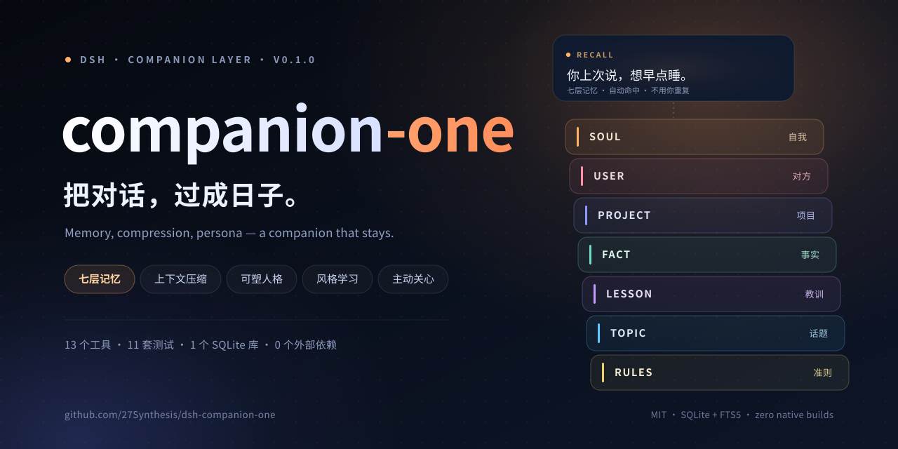
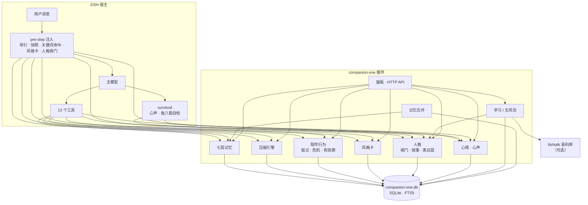

<div align="center">
  <a href="README.en.md">English</a> · <a href="README.md"><b>简体中文</b></a>
</div>

<div align="center">
  
</div>

<div align="center">

**一个插件，一整套陪伴系统。**

DSH 的长期记忆、上下文压缩、陪伴分寸与说话方式，全部内置。  
不需要装第二个插件，不需要编译任何原生模块。

[](LICENSE)
[](#运行要求)
[](#安装)
[](#测试)
[](#数据与隐私)

</div>

---

## 为什么是「单体」

DSH 的会话越聊越长，主模型的上下文却只有那么大：旧对话被折叠、被遗忘，聊到第三天它已经不认识你。

常见的解法是装一堆插件——压缩一个、记忆一个、陪伴一个、人设又一个，彼此抢工具名、抢注入点，维护成本比模型本身还高。

**Companion One 把这些能力收进同一个包**：一个 SQLite 库、一套注入预算、一份面板，互相知道对方在做什么。装一个，就够了。

- **自包含**：不声明任何外部插件为依赖，持久化只用 Node 内置 `node:sqlite`（Android proot 上零原生编译，FTS5 直接可用）。
- **不接管流量**：压缩靠 DSH 的 Session surface replace 完成，不代理网络、不改写请求。
- **缓存友好**：静态导引恒定不变，动态上下文走一次性注入，不破坏 provider 的 KV 缓存。

## ✨ 特色一览

| | 能力 | 一句话 |
| :--: | --- | --- |
| 🧠 | **七层长期记忆** | soul / user / project / fact / lesson / topic / rules，按人隔离，事实带有效期与键失效 |
| 🗜️ | **内置压缩引擎** | 分层折叠、只收「确实更短」的摘要、稳定块引用、被折叠原文可检索可还原 |
| 💗 | **陪伴行为层** | 惦记清单、到期分寸、危机词法分级、对话安静期的自我克制 |
| 🗣️ | **沟通风格学习** | 从句长、口头禅、标点、表情学起，只学形状，不搬内容 |
| 🎭 | **可塑人格** | 反应 / 链条 / 叙事三张表 + 四个阀门，可 promote、可 rollback、可冻结 |
| 🐟 | **说人话底座** | 移植 fishtalk 的硬规则与统计判定，每轮自检「鱼八股」，下一轮自动纠偏 |
| 💬 | **心情 + 心声** | valence / energy 两因素心情，每轮一句第一人称心声，只展示、不写回人格 |
| 📚 | **学习中心** | B 站分区/搜索联网学习、投喂聊天记录、蒸馏文风包，学到的口气回流到表达层 |
| 🔀 | **记忆合并** | 从 Mnemon 运行时记忆 / 项目文档 / 其他 SQLite 记忆表只读导入，自动分层去重 |
| 🖥️ | **面板 + 工具** | 8 个页签的设置面板、13 个工具、8 个 dshGo 原生视图、HTTP API |
| 🧩 | **11 套测试** | 压缩、记忆、陪伴、风格、人格、心情、学习、导入、冲突、回归全覆盖 |
| 🛡️ | **安全细节** | 导入只读、密钥过滤、写接口防 CSRF、冲突时整体让位 |

## 🧩 功能全景

### 1）上下文压缩引擎

在插件内实现了一套与宿主压缩工具语义一致的四件套，数据落在同一个库：

- **`compress`**：提交忠实摘要，折叠较早对话；只接受 **比原文更短** 的摘要（阈值 85%），避免「摘要越压越大」；保留最近 3 条原文。
- **`decompress`**：按块引用（`b1`、`b7`…）分页还原被折叠的原文。
- **`search_context`**：在归档摘要与原文上做 FTS5 BM25 检索，中文按二元组兜底。
- **`acp_status`**：上下文压力、可压缩范围、分层块列表；无 live session 时回退到最近一次落库的压力值。

细节：压力提示分 45% / 75% / 95% 三档；超时 60 秒的 pending 块标记 orphan；被 billion-context 占用工具名时自动整体让位，不抢注册。

### 2）七层长期记忆

`soul（自我）/ user（对方）/ project（项目）/ fact（事实）/ lesson（教训）/ topic（话题）/ rules（准则）`

- **去重合并**：同层语义相近自动合并；`fact` 层同一事实键的新值让旧值失效，历史可回溯。
- **有效期**：事实可设置 `valid_until`，启动时与每 10 分钟清理过期项。
- **检索**：FTS5 + 关键词兜底，支持按 scope（对话对象）隔离。
- **自动落库**：用户说「记住……」时正则直接写 fact（`auto:explicit`），重复会合并。
- **注入策略**（缓存友好）：system prompt 只注册一次静态导引；首轮注入 soul/user/rules 摘要；第二条消息起注入关键词命中 top-2；压缩后下一轮按预算重新注入（≤300 token）。

### 3）陪伴行为层

- **按人隔离**：`resolveScope` 三级回退（session header → 绑定 → 默认 → global），同一台设备上的不同对话各记得各的。
- **惦记清单（followup）**：`add / list / done / silence`，带到期时间与大小标记；每天最多提醒一件，对方情绪明显负面或说过「别问了」时自动静默。
- **危机分级**：零成本词法判断 0–5 级（平稳 → 轻微低落 → 明显负面 → 消沉 → 自伤风险 → 急迫危机），只用于调整回应分寸，不替代专业判断；等级在两轮之间不衰减，需要在面板手动清除。

### 4）沟通风格学习

- 从用户原话统计：句长、直接度、口头禅、标点习惯、emoji 频率、称呼与语气词。
- 产出**风格卡**（≤200 token 注入），可在面板增删改、开关；关闭后立即停止注入，已有卡片保留。
- 面板「风格」页支持手动「学一句」与删除单条。

### 5）可塑人格

- **三张表**：`persona_reaction`（反应）、`persona_chain`（链条）、`persona_narrative`（叙事）。
- **四个阀门**：注意（机会/威胁/关系/任务）、解释（方法/能力/情境/他人）、情绪阈值（0–1，越高越稳）、目标优先级（0–1）。每轮最多微调一个阀门，注入 ≤150 token。
- **版本与冻结**：`promote` 提交新叙事会新增版本；`rollback` 回滚；`freeze` 只读。
- **⑤ 表达层**：四阀门决定「先看什么」，表达层决定「话怎么说」——它读取学习中心蒸馏出的**文风包**，把场合口吻带给当前回复。

### 6）说人话：fishtalk 规则

把 fishtalk 的判定规则移植进插件（MIT），不依赖它在线：

- 硬证据原句、AI 腔软信号、引号豁免、二元组相似度；`checkText` 给出命中与改写提示。
- **每轮自检**：`turn/end` 检查上一轮回复，命中「鱼八股」就写入 `voiceHint`（≤60 token），下一轮自动纠偏。
- 规则覆盖：「这条我认」「我记下了」「不是 A 而是 B」「作为一个 AI」这类典型腔调。

### 7）心情与心声

- **两因素心情**：valence（好坏）/ energy（能量）→ need（此刻需要什么）；情绪有 15 分钟余温，危机等级直接压低 valence。
- **心声**：`heart_voice` 工具每轮写一句 20–60 字的第一人称内心话，落 `session_state`；只给自己看，不写回人格、不反哺叙事；模型没写时用 `fallbackHeartVoice()` 兜底并标注 `auto`。
- 面板「概览」实时显示最近一句心声、模型/自动、心情与时间。

### 8）学习中心

- **B 站学习**：按分区或「搜:关键词」找高讨论视频，抓高赞评论与弹幕（触发风控会停，不硬闯）；后台任务状态写 kv，面板 3 秒轮询进度，支持取消。
- **投喂语料**：一行一条，喂进 fishtalk 语料库并重新蒸馏。
- **文风包**：按场合蒸馏语气统计；面板可固定 `packScene`，也可关掉 `voicePack` 省 token。私聊没有语料时会借最大场合的口气，并明确标注「只借句式和口癖」。

> 学习能力需要本机装有 [fishtalk](https://github.com/Nozzi2455/fishtalk) 插件；找不到时返回 `fishtalk_missing`，其余功能不受影响。

### 9）记忆合并

- 扫描三类来源：Mnemon 运行时记忆（`memories.json`，缺失时回退 MEMORY.md / USER.md）、Mnemon 项目文档、DSH_HOME 下其他含记忆表的 SQLite 库。
- **只读**：源文件零写入；跳过疑似密钥（`sk-` / `ghp_` / Bearer / 密码=）、过短与正则碎片；单次上限 500 条。
- **分类**：来源提示优先，否则按关键词给七层打分，拿不准落 fact；导入走 `remember()`，同层相近自动合并、fact 键新值让旧值失效，重复导入幂等。

### 10）面板、原生视图与 API

- **8 个页签**：概览 / 记忆 / 设定 / 学习 / 压缩 / 惦记 / 风格 / 人格。
- **dshGo 原生**：`陪伴速览` 面板 + 输入框上方的 `moodstrip` 胶囊，实时显示心情、压力与最近心声。
- **HTTP API**：`/companion-one/api`（prefix 路由，与工具共用 `lib/api.js` 的 `runOp`）。写操作只接受 `POST` + `application/json`，GET 返回 405、text/plain 返回 415，防止跨站页面直连本机端口。

## 🏗 架构



## 📦 安装

**运行要求**：Node.js ≥ 22.13、DSH ≥ 0.2（dsh-go）。

```bash
git clone https://github.com/27Synthesis/dsh-companion-one.git
cd companion-one

# 方式一：link 安装（源码即部署，改完重启引擎生效）
dsh plugin --profile web add link:$(pwd)

# 方式二：手动放进插件目录
cp -r . "$DSH_HOME/dsh-go/plugins/companion-one"
```

装好后在 **设置 › 本机引擎 › 重启**，面板出现在「设置 › 陪伴」或「插件 › 陪伴」；对话里会多出 13 个工具。

> 改 `lib/` 或 `index.js` 需重启引擎；改 `client.js` 刷新面板所在页面即可。
> 卸载插件不会删除数据库；重装后记忆原样恢复。

## 🔧 配置

面板「陪伴 › 概览」可一键开关；也可在 bundle 配置里预置：

```yaml
- insert:
    - id: companion-one
      name: companion-one
      config:
        compression: true
        memory: true
        companion: true
        style: true
        persona: true
        # dbPath: /absolute/path/companion-one.db
```

| 设置 | 默认 | 作用 |
| --- | :--: | --- |
| `memory` | 开 | 七层记忆注入与命中；关闭后 `memory_*` 仍可手写 |
| `compression` | 开 | 压缩工具与压力提示；关闭后 `compress` 返回 `disabled` |
| `companion` | 开 | 危机分级与惦记提醒 |
| `style` | 开 | 风格卡注入；关闭即停，已有卡片保留 |
| `persona` | 开 | 四阀门与叙事注入 |
| `voicePack` | 开 | 文风包进 ⑤ 表达层（关掉可省 ~60–80 token/轮） |
| `packScene` | 空 | 固定某一场合的语气；空 = 按对话自动挑 |
| `personaFrozen` | 关 | 人格只读，不再 promote/rollback |

## 🧰 工具与 API

**13 个工具**

| 分组 | 工具 | 说明 |
| --- | --- | --- |
| 记忆 | `memory_add` `memory_search` `memory_update` `memory_list` `memory_forget` | 增删改查、归档、失效；`memory_add` 支持层、关键词、有效期、scope |
| 压缩 | `compress` `decompress` `search_context` `acp_status` | 折叠、还原、检索、压力与块列表 |
| 陪伴 | `followup` | `add / list / done / silence`，带到期时间与大小 |
| 风格 | `style_card` | `view / toggle / delete` |
| 人格 | `persona` | `status / promote / rollback / freeze` |
| 心声 | `heart_voice` | 每轮一句第一人称内心话 |

**HTTP API**：`POST /companion-one/api`，JSON body `{"op": "...", ...}`。常用 op：`overview`、`memories`、`memoryAdd`、`memoryImportScan`、`memoryImportRun`、`blocks`、`decompress`、`searchContext`、`acpStatus`、`followups`、`followupAdd`、`style`、`persona`、`ftStats`、`ftPack`、`ftFeed`、`ftLearn`、`ftJob`、`heartVoice`、`setSetting`、`setScope`。

## 🔐 数据与隐私

- **全部本地**：记忆、压缩归档、风格卡、人格轨迹、心情与心声都在一个 SQLite 文件里：
  `<DSH_HOME>/companion-one/companion-one.db`（WAL 模式，FTS5 全文索引）。
- **没有云端**：插件本身不发起任何网络请求；只有「学习中心」的 B 站学习会联网（由 fishtalk 执行），随时可停。
- **导入只读**：合并其他插件记忆时不会修改来源；疑似密钥与隐私片段会被跳过。
- **可审计**：块引用、版本号、来源标记（`import:mnemon:runtime` 等）都留在表里，面板可见可撤销。

## ⚡ 设计取舍

1. **不接管流量**：压缩用 Session surface replace，失败可回退，不引入代理进程。
2. **零额外模型调用**：压力 ≥95% 时只注入提示，由当前模型自己调 `compress`，白天每轮成本不增加。
3. **注入一次即弃**：风格卡、人格阀门、文风包都走一次性提示，不写进 system prompt，KV 缓存保持命中。
4. **冲突让位**：`compress/decompress/search_context/acp_status` 被别的 provider 注册时整体不注册；重名工具加 `co_` 前缀或降级重试，绝不炸启动。
5. **宁缺毋滥**：记忆不自动抽取对话（除「记住……」显式指令），避免把闲聊沉淀成错误事实；摘要只收更短的。

## ⚠️ 已知边界

- 「急迫危机」只写状态与提示，**不会主动推送系统通知**（dshGo 暂未开放插件侧通知能力）。
- 危机分级是词法判断，可能漏判/误判，不替代专业帮助。
- 私聊语料尚未内置：没有聊天记录可学时，会借公开语料的句式，并明确标注。
- 压缩是「模型决定何时压」，不是自动定时压；这是为零额外调用做的取舍。
- 学习任务跑在引擎进程内，重启会中断（30 分钟超时自动重置）。

## 🧪 测试

```bash
node --test test/*.test.mjs
```

| 套件 | 覆盖 |
| --- | --- |
| `host` | 宿主接线、工具注册、pre-step 注入、多 step 去重、面板路由鉴权 |
| `acp` | 压缩/还原/检索、阈值、块引用、orphan |
| `behaviour` | 事实失效、惦记节奏、危机分级、风格、人格 |
| `mood` | 两因素心情、余温、心声兜底 |
| `learn` | 投喂、后台任务、取消、僵尸任务 |
| `fishtalk` | 八股判定、相似度、引号豁免 |
| `import` | 三类来源、分类、去重、密钥过滤 |
| `client` | 面板组件与 API 调用 |
| `conflict` | 工具名冲突让位 |
| `auto` | 「记住…」自动落库 |
| `regression` | 历史 bug 回归 |

## 📁 目录结构

```
companion-one/
├── index.js          # 宿主入口：注入点 / 工具注册 / 面板路由 / dshGo 原生面板
├── client.js         # 设置面板 UI（8 个页签，无构建步骤）
├── lib/
│   ├── db.js         # 表结构 + FTS5 + 迁移
│   ├── memory.js     # 七层记忆
│   ├── acp.js        # 压缩引擎
│   ├── inject.js     # 注入与预算
│   ├── companion.js  # scope / 惦记 / 危机 / 有效期
│   ├── style.js      # 风格卡
│   ├── mood.js       # 心情 + 心声
│   ├── persona.js    # 人格与 ⑤ 表达层
│   ├── fishtalk.js   # 说人话规则
│   ├── learn.js      # 学习中心 / 文风包
│   ├── import.js     # 记忆合并
│   └── api.js        # 面板与工具共用的 op 分发
├── locale/           # 中英文元数据
├── test/             # 11 套测试
├── docs/banner.svg
├── icon.svg
├── cordis.patch.yml
└── package.json
```

## 🗺 路线图

- [ ] 私聊语料：投喂 QQ/微信聊天，让私聊用真的聊天口气
- [ ] 心情两轴可视化（valence × energy）与心声时间线
- [ ] 导入来源分布视图，支持按来源一键撤销
- [ ] 多人群隔离的前端入口（`setScope` 后端已就绪）
- [ ] 危机等级 5 的主动提醒（等 dshGo 开放能力）
- [ ] 压缩块实体反哺 `fact` 层

## 🙏 机制来源与许可

本仓库代码为**原创实现**，只借鉴下列项目的机制与规则，未整体搬用其代码树或构建脚本：

- **压缩工具语义与分层折叠**：[billion-context](https://github.com/ranxianglei/billion-context) —— 四件套、只收更短摘要、稳定块引用、tier 分层；此处用 `node:sqlite` 重写，不接管网络。
- **七层记忆 schema 与注入路径**：[dsh-meow-memory](https://github.com/Phant0Meow)（MIT）—— 表结构思路与三条注入路径；保留其 MIT 许可与来源说明。
- **陪伴行为机制**：[dsh-companion-memory](https://github.com/lvzhuojun) —— 按人隔离、事实有效期、到期跟进的分寸、危机词法分级；存储层与引擎自研。
- **风格学习思路**：[dsh-natural-dialogue](https://github.com/aki66938) —— 「表达从用户原话学习」；存储与注入自行实现。
- **说人话规则**：[fishtalk](https://github.com/Nozzi2455/fishtalk)（MIT）—— 判定规则与语料蒸馏接口。

代码注释里对每个借鉴点标注了来源仓库与文件路径。

## 📄 License

[MIT](LICENSE)

---

<div align="center">
  <sub>Built for DSH · 记忆留在本地，分寸留在心里。</sub>
</div>
